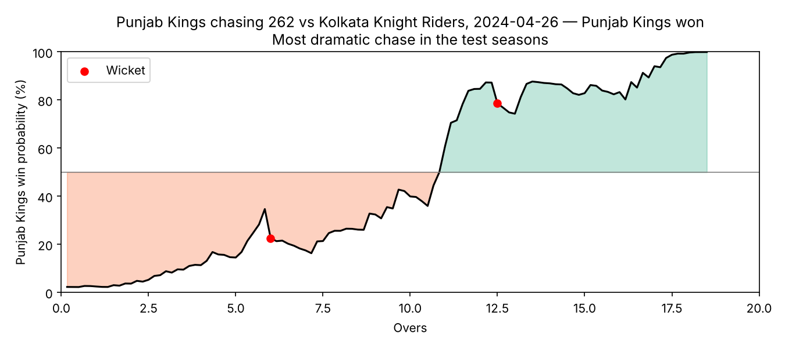
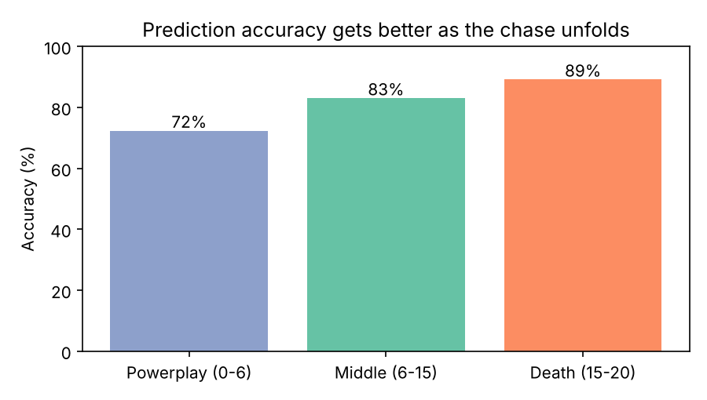
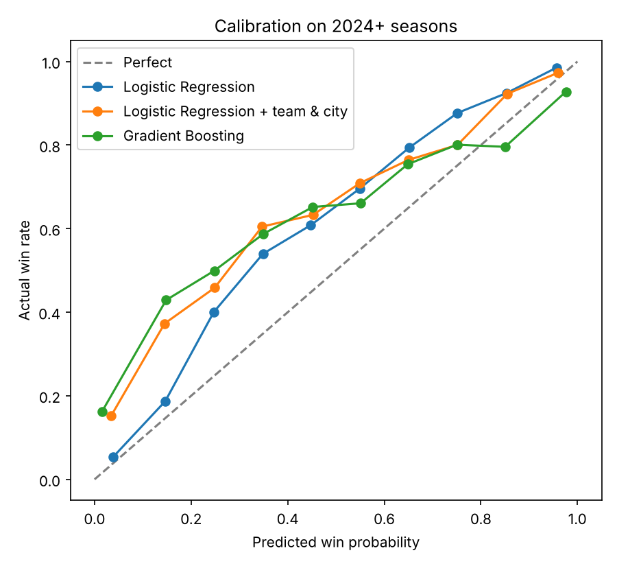
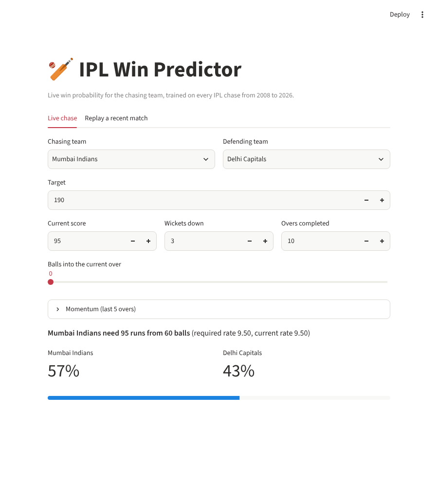

# IPL Win Predictor 🏏

Ball-by-ball **win probability for the chasing team** in an IPL match, trained on every completed run chase from 2008 to 2026, with a Streamlit app to use it live or replay recent matches.

**Result:** on the 2024–2026 seasons (208 matches the model never saw), it picks the eventual winner **80.6%** of the time across all balls — rising to **89%** in the death overs — with ROC-AUC 0.91.



*Punjab Kings' record chase of 262 vs KKR (2024), from the held-out test seasons. The model gave them ~1% at the start and swung to their side by the 11th over.*

## How it works

**1. Data** — ~295k deliveries and 1,243 matches (Cricsheet data via [ritesh-ojha/IPL-DATASET](https://github.com/ritesh-ojha/IPL-DATASET)).

**2. Cleaning** ([`src/prepare_data.py`](src/prepare_data.py)) — the raw data has real problems:
- Franchise renames merged (Delhi Daredevils → Delhi Capitals, Kings XI Punjab → Punjab Kings, …).
- **Wides and no-balls** don't use up one of the 120 legal balls.
- **44 rain-affected matches dropped** — with DLS or reduced overs the real target isn't "first-innings score + 1", so these would teach the model wrong patterns. Detected automatically from innings that ended early without being bowled out.
- Ties (super overs) and no-results dropped.

**3. Features** — one row per legal ball of each chase (130,767 rows), describing the state after that ball:

| Feature | Meaning |
|---|---|
| `target`, `runs_left`, `balls_left`, `wickets_left` | the core state of the chase |
| `crr`, `rrr` | current and required run rate (capped at 36/over) |
| `runs_last_5`, `wickets_last_5` | **momentum** — runs and wickets in the last 30 deliveries |

**4. Evaluation by season, not random split** ([`src/train.py`](src/train.py)) — train on 2008–2023, test on 2024–2026. A random split would leak: balls from the same match would land in both train and test. Splitting by season also answers the real question: *does it work on future seasons?*

## Results (2024–2026, 22,721 balls)

| Model | Log loss ↓ | Brier ↓ | Accuracy | ROC-AUC |
|---|---|---|---|---|
| Baseline (always predict 55% chase win rate) | 0.691 | 0.249 | 53.5% | 0.50 |
| **Logistic Regression (match state)** | **0.402** | **0.131** | **80.6%** | **0.911** |
| Logistic Regression + team & city | 0.536 | 0.169 | 76.2% | 0.867 |
| Gradient Boosting (match state) | 0.637 | 0.173 | 76.5% | 0.864 |

Log loss and Brier score measure the *quality of the probabilities*, which matters more than accuracy here — the app shows "62%", not just a winner.



## What I learned

- **Adding team names made the model worse.** Squads are reshuffled at every auction, so "Mumbai Indians 2015" tells you nothing about "Mumbai Indians 2025" — the model just memorised old team strengths. Pure match-state features generalise much better.
- **Scoring has shifted.** The average target rose from 166 (2008–23) to 194 (2024–26). Tree models can't extrapolate beyond the targets they've seen, so gradient boosting became overconfident on 230+ chases; logistic regression handles this better.
- **There's still drift.** The calibration plot shows the model trained on 2008–23 *underrates* chasing teams in 2024–26 — chasing got easier (impact-player rule, flatter pitches). The shipped model is refit on all seasons including 2024–26 to account for this.



## The app



- **Live chase:** enter target, score, overs and wickets → win probability for both sides.
- **Replay a recent match:** pick any 2024–26 match and see the probability curve ball by ball, with wickets marked.

## Run it

```bash
pip install -r requirements.txt

streamlit run app.py              # works straight away (model + sample data are included)

# to rebuild everything from scratch:
python src/download_data.py       # ~25 MB raw CSVs into data/raw/
python src/prepare_data.py        # -> data/processed/chase_states.csv
python src/train.py               # compares models, saves models/win_predictor.joblib + figures
pytest                            # data-cleaning and model sanity tests
```

## Project structure

```
app.py                     Streamlit app
src/download_data.py       fetch raw ball-by-ball + match data
src/prepare_data.py        cleaning + one row per ball of each chase
src/model.py               feature lists and model pipelines
src/train.py               season-based evaluation, plots, saves model
tests/test_pipeline.py     tests for cleaning logic and model behaviour
data/sample/               2024–26 chase states (used by the app's replay tab)
models/                    trained model (8 KB)
reports/                   metrics.json, model_comparison.csv, figures
```

## Data credit

Ball-by-ball data from [Cricsheet](https://cricsheet.org), packaged as CSV by [ritesh-ojha/IPL-DATASET](https://github.com/ritesh-ojha/IPL-DATASET).
